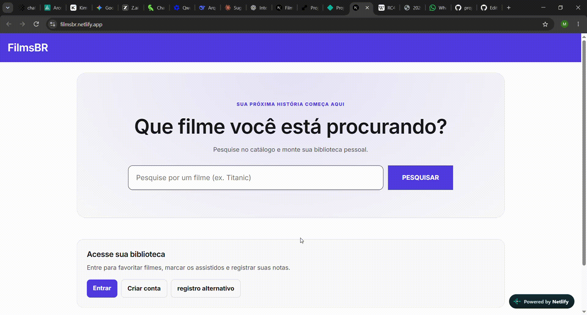

# FilmsBR



Aplicação web para pesquisar filmes e manter uma biblioteca pessoal. Com uma conta, a pessoa pode marcar filmes como favoritos ou assistidos e registrar uma avaliação. As informações de catálogo vêm da API do The Movie Database (TMDB).

## Acesso

Aplicação publicada: [[project3-2026b-gabriel-s-franca-mig.vercel.app/](https://project3-2026b-gabriel-s-franca-mig.vercel.app/)]

## Desenvolvedores

- **Gabriel da Silva França** — estudante da disciplina de Desenvolvimento de Software para a Web.
- **Miguel Miron Silva** — estudante da disciplina de Desenvolvimento de Software para a Web.

## Proposta

Desenvolver uma aplicação web com cadastro e autenticação de usuários, integrando frontend, backend e persistência de dados. O projeto aplica essa proposta a um catálogo de filmes: visitantes podem pesquisar títulos e consultar detalhes; usuários autenticados podem manter estados pessoais dos filmes em uma biblioteca.

## Funcionalidades

- Pesquisa de filmes e consulta de detalhes e créditos pelo TMDB.
- Cadastro de usuário e login com nome de usuário ou e-mail.
- Biblioteca vinculada à conta, com estados de favorito, assistido e nota pessoal.
- Persistência local em SQLite.
- Interface responsiva em português.

## Executar localmente

### Requisitos

- Python 3.10 ou superior.
- Node.js compatível com Next.js 16 e pnpm.
- Chave de API do TMDB.

### Backend

No diretório `backend`, crie um arquivo `.env` com as configurações abaixo. Use uma chave JWT longa e aleatória; não compartilhe nem versione esse arquivo.

```env
TMDB_API_KEY=sua_chave_do_tmdb
JWT_SECRET_KEY=uma_chave_secreta_longa_e_aleatoria
```

Instale as dependências e inicie a API:

```bash
cd backend
python -m venv .venv
```

Ative o ambiente virtual (Windows: `.venv\Scripts\Activate.ps1`; macOS/Linux: `source .venv/bin/activate`) e rode:

```bash
pip install -r requirements.txt
uvicorn app.main:app --reload
```

A API ficará em `http://127.0.0.1:8000`. A documentação interativa está disponível em `http://127.0.0.1:8000/docs`. O banco `webapp_filmes.db` é criado no diretório de execução do backend.

### Frontend

Em outro terminal, configure e inicie a aplicação:

```bash
cd frontend
pnpm install
pnpm dev
```

Acesse `http://localhost:3000`. O cliente da API usa `http://127.0.0.1:8000/api` por padrão. Para outro ambiente, defina `NEXT_PUBLIC_API_BASE_URL` antes de iniciar o frontend (por exemplo, `http://127.0.0.1:8000/api`).

## API

| Método | Rota | Acesso | Descrição |
| --- | --- | --- | --- |
| `GET` | `/api/movies/search?query=...` | Público | Pesquisa filmes no TMDB. |
| `GET` | `/api/movies/{tmdb_id}` | Público | Consulta detalhes de um filme. |
| `GET` | `/api/movies/{tmdb_id}/credits` | Público | Consulta créditos do filme. |
| `POST` | `/api/auth/register` | Público | Cria uma conta. |
| `POST` | `/api/auth/login` | Público | Autentica e retorna um token Bearer. |
| `GET` | `/api/auth/me` | Autenticado | Retorna os dados da conta atual. |
| `GET` | `/api/my-movies/` | Autenticado | Lista estados de filmes da conta. |
| `GET` | `/api/my-movies/{tmdb_id}` | Autenticado | Consulta o estado de um filme. |
| `PATCH` | `/api/my-movies/{tmdb_id}` | Autenticado | Atualiza favorito, assistido ou nota. |
| `DELETE` | `/api/my-movies/{tmdb_id}` | Autenticado | Remove o estado do filme. |

## Desenvolvimento

### Processo

# 🎬 Desenvolvimento do Front-end do Web App

## 🖥️ 1. Desenvolvimento da interface

O desenvolvimento do front-end do web app foi realizado utilizando **Next.js com TypeScript**, buscando separar a aplicação em componentes reutilizáveis e manter uma estrutura organizada.

A interface foi construída com **CSS Modules**, permitindo que os estilos de cada componente fossem isolados e evitando conflitos entre diferentes partes da aplicação.

Entre as principais funcionalidades desenvolvidas estão:

- 🔎 busca e visualização de filmes;
- 🎬 página de detalhes do filme;
- ⭐ avaliação pessoal de **1 a 10**;
- ❤️ gerenciamento de filmes favoritos;
- 👁️ controle de filmes assistidos;
- 👤 tela de perfil do usuário;
- 🔐 cadastro e login.

O front-end também possui uma camada específica para comunicação com a API, responsável por centralizar as requisições realizadas ao backend.

---

## 🔐 2. Autenticação

Um dos principais pontos do desenvolvimento foi a implementação do processo de **autenticação**.

> **Autenticação** é o processo de verificar **quem é o usuário**.

No fluxo desenvolvido, o usuário informa suas credenciais na tela de login. O front-end envia esses dados para o backend, que verifica as informações e, caso estejam corretas, retorna um **access token**.

Esse token é armazenado durante a sessão do usuário no navegador.

A partir desse momento, as requisições que precisam identificar o usuário recebem o token no cabeçalho HTTP:

```text
Authorization: Bearer <access_token>
```

Dessa forma, o backend consegue identificar quem está realizando cada requisição.

---

## 🛡️ 3. Autorização

Além da autenticação, foi necessário implementar o conceito de **autorização**.

> **Autorização** determina **o que um usuário autenticado pode acessar ou modificar**.

Isso é especialmente importante para os dados pessoais da aplicação.

Por exemplo, quando o usuário marca um filme como favorito, como assistido ou atribui uma nota, essa informação é associada à sua própria conta.

O front-end utiliza os endpoints protegidos da API para consultar e modificar esses dados, enquanto o backend verifica o token recebido antes de permitir a operação.

Podemos resumir o fluxo assim:

| Etapa | Processo |
|---|---|
| 👤 1 | Usuário realiza o login |
| 🔑 2 | Backend valida as credenciais |
| 🎟️ 3 | Backend retorna o token |
| 💾 4 | Front-end mantém o token durante a sessão |
| 📡 5 | Token é enviado nas requisições protegidas |
| 🛡️ 6 | Backend identifica e autoriza o usuário |
| 🎬 7 | Dados pessoais são consultados ou alterados |

---

## 👤 4. Perfil e dados pessoais

Com a autenticação funcionando, foi possível desenvolver uma tela de **perfil do usuário**.

Nela, são apresentados os filmes associados à conta, principalmente os **favoritos** e os **assistidos**.

A aplicação consulta os estados pessoais armazenados pelo backend e combina essas informações com os dados dos filmes para montar os cartões exibidos na interface.

Isso permite que diferentes usuários tenham suas próprias coleções, sem misturar seus dados.

---


### Trechos de código para destaque

1. **Hash e verificação de senha** — `backend/app/services/auth.py`: `PasswordHash.recommended()` cria o hash no cadastro, e `password_hash.verify(...)` valida a senha no login sem armazená-la em texto puro.
2. **Token de acesso** — `backend/app/services/auth.py`: `create_access_token` assina um JWT com identificador do usuário (`sub`) e expiração; `backend/app/auth.py` protege as rotas que exigem login.
3. **Atualização parcial da biblioteca** — `backend/app/routes/user_movies.py`: a rota `PATCH` considera apenas os campos enviados (`model_fields_set`), permitindo alterar um estado sem sobrescrever os demais.
4. **Integração com o catálogo** — `backend/app/services/tmdb.py`: as chamadas à API externa usam o token configurado no ambiente, verificam erros HTTP e têm timeout.

## Tecnologias

### Linguagens e ferramentas

- **TypeScript, React 19 e Next.js 16** no frontend, com CSS Modules.
- **Python e FastAPI** no backend, com endpoints REST e documentação OpenAPI.
- **SQLAlchemy e SQLite** para modelos e persistência.
- **Pydantic Settings** para carregar configurações do ambiente.
- **PyJWT** para tokens, **pwdlib/Argon2** para hash de senha e **Requests** para chamadas ao TMDB.
- **Lucide React** para ícones da interface.
- **pnpm** para dependências do frontend e **pip** para dependências do backend.

### Autenticação e autorização

O cadastro recebe nome de usuário, e-mail e senha. O backend armazena o hash da senha e rejeita duplicatas de usuário ou e-mail. O login aceita usuário ou e-mail e retorna um JWT Bearer com validade de 30 minutos. O frontend envia o token nas requisições protegidas; o backend identifica a conta pelo token e limita as operações da biblioteca aos dados daquele usuário.

### Ambiente de desenvolvimento

- Editor de código e terminal com suporte a Python e Node.js.
- Python com ambiente virtual, FastAPI e Uvicorn para executar a API.
- Node.js e pnpm para executar o Next.js.
- Navegador para acessar a aplicação e a documentação interativa da API.
- Variáveis locais em `backend/.env` para credenciais e segredo JWT; esse arquivo não deve ser enviado ao repositório.

## Referências e créditos

- [The Movie Database (TMDB) API](https://developer.themoviedb.org/docs) — busca, dados e créditos de filmes. Os dados e imagens pertencem ao TMDB e são fornecidos conforme os termos da plataforma.
- [Documentação do Next.js](https://nextjs.org/docs) — framework do frontend.
- [Documentação do FastAPI](https://fastapi.tiangolo.com/) — framework da API.
- [SQLAlchemy ORM](https://docs.sqlalchemy.org/) — persistência relacional.
- [Lucide](https://lucide.dev/) — biblioteca de ícones.
- [Disciplina Desenvolvimento de Software para a Web](https://github.com/andreainfufsm/elc1090-2026b) — contexto acadêmico do projeto.

---

Projeto desenvolvido para a disciplina de [Desenvolvimento de Software para a Web](https://github.com/andreainfufsm/elc1090-2026b), em 2026b.
